# VIGIL OS

VIGIL OS is a Linux distribution based on Fedora 44, created by Brad Heffernan. It comes in two editions: KDE Plasma on Wayland, and i3 on X11. Both use the dark VIGIL artwork on the boot, login and lock screens and in the installer, with a lighter landscape painting by [byrotek](https://www.deviantart.com/byrotek) on the desktop, used with the artist's permission. Both default to dark themes and the white Qogir cursor.

The KDE edition includes SDDM, Dolphin, Konsole, Kate and Discover. The i3 edition includes LightDM, Polybar, Rofi, i3lock-color, Greenclip, Alacritty and Thunar. Both come with Brave as the default browser, LibreOffice, Node.js, npm, Python, Flatpak and VIGIL Ask. System updates come from the signed Fedora and Brave repositories through RPM and DNF5.

VIGIL OS is still in development. Both 1.10 editions passed BIOS and UEFI live boot, a fresh UEFI install, booting without the ISO, branded login, lock/unlock and reboot in virtual machines. Each passed all 53 VIGIL Ask tests against the installed 0.3.1 package, plus the full signed VpM example-package workflow, with SELinux enforcing and no denials or failed system/user services. Ask obtained a real device code, opened the external verification page and cancelled without approval; streaming and account lifecycle regressions use a local test server. Production account approval, real questions, credits and history remain owner acceptance. Physical hardware, Secure Boot, BIOS installation, HiDPI and multi-monitor setups remain untested, and DNF update acceptance was not repeated for 1.10. Passing the source checks does not qualify a new ISO; each build needs testing.

## Screenshots

Version 1.10 (Loopback), captured from fresh installed systems at native 1920×1080 (16:9).

### KDE Plasma

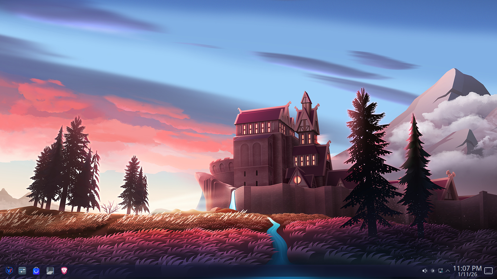

| Application menu | Welcome Center |
| --- | --- |
| 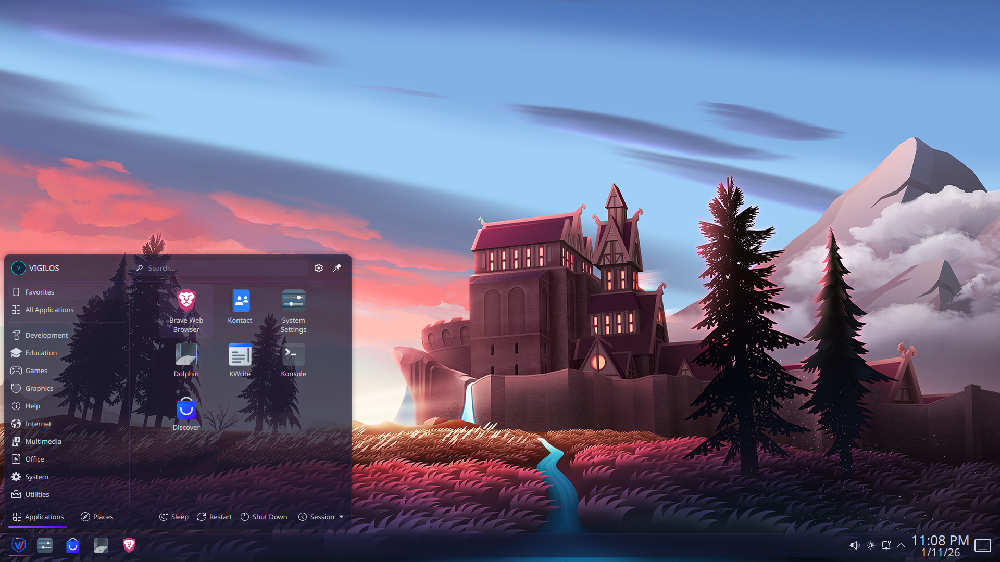 | 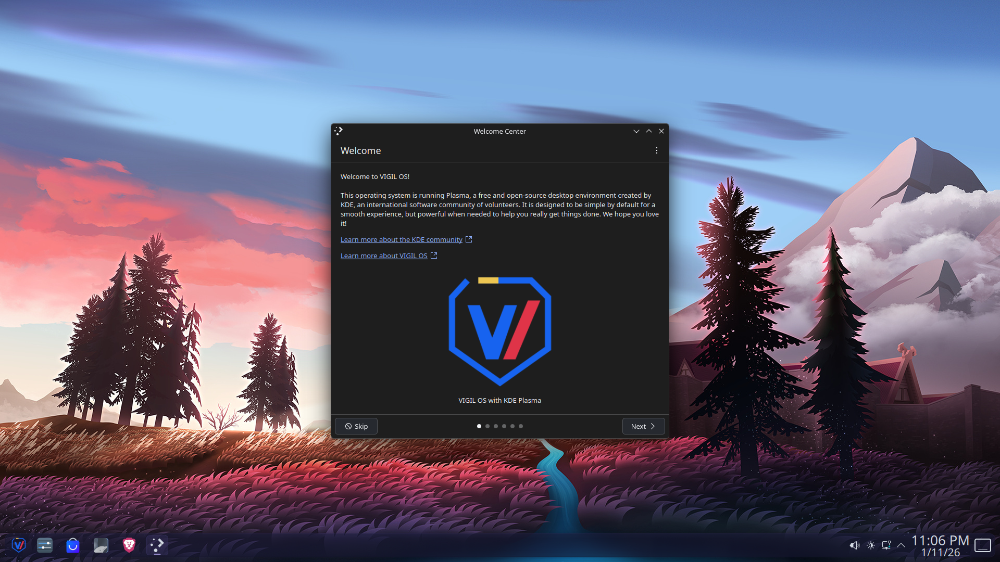 |

| Login | Lock screen |
| --- | --- |
| 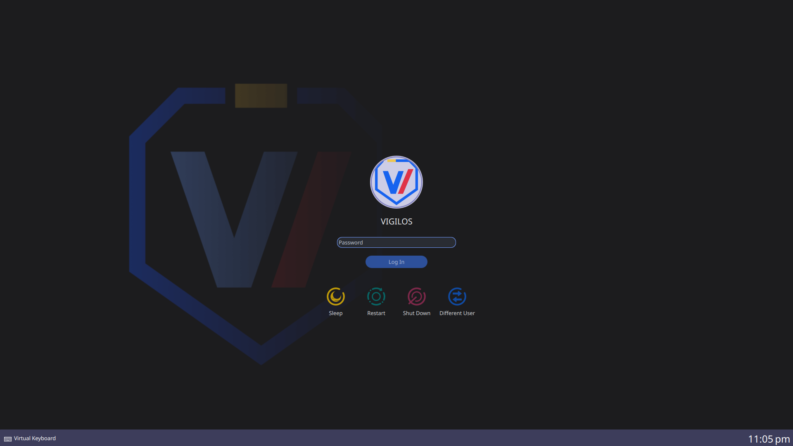 | 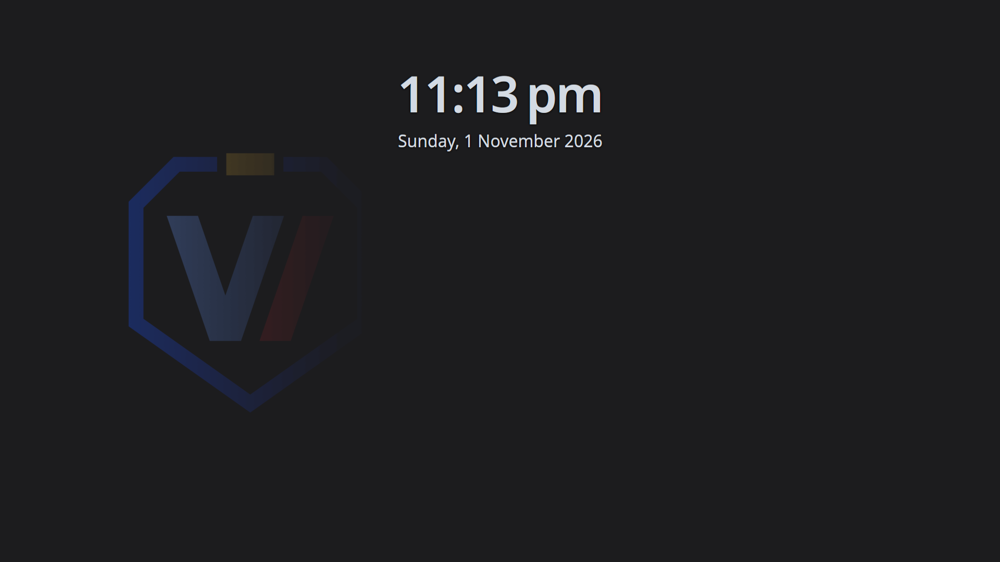 |

### i3

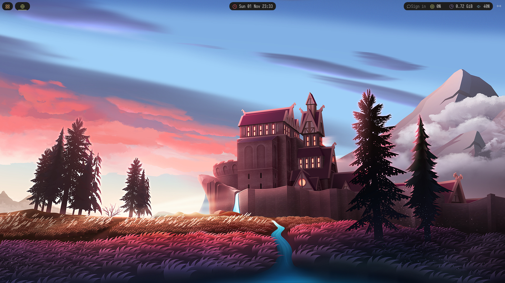

| Application launcher | Login |
| --- | --- |
| 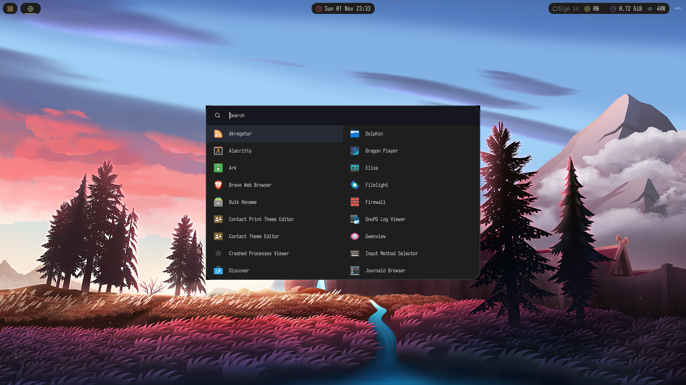 | 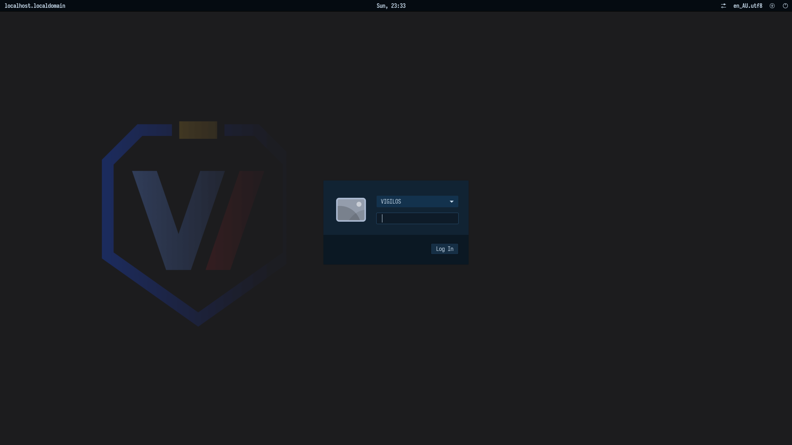 |

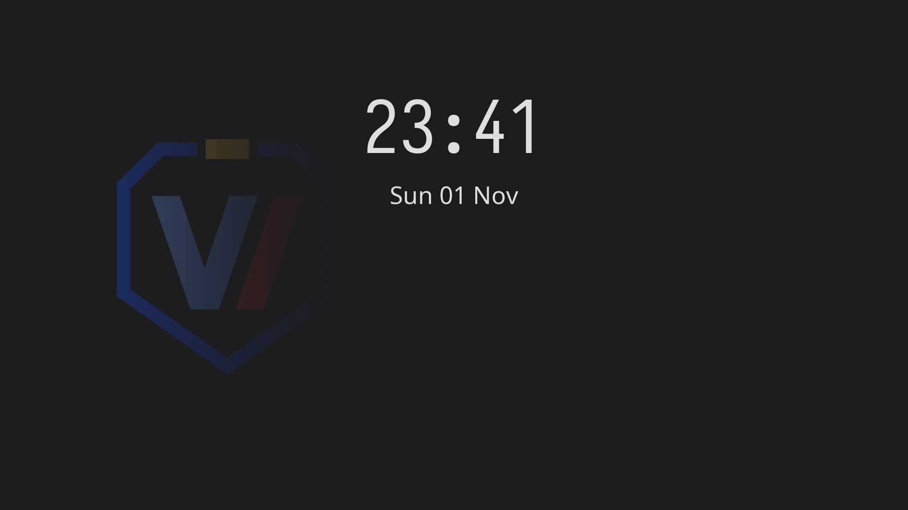

## Building the ISO

You need Bash, Python 3, curl, gpgv, the OpenSSH client tools, xorriso, QEMU with qemu-img, and working KVM access. Run the build as your normal user from the repository directory:

```bash
bash scripts/build-and-brand.sh
```

That builds both editions, one after the other. To build one edition, or to check the source and host tools without building anything:

```bash
bash scripts/build-and-brand.sh --desktop kde
bash scripts/build-and-brand.sh --desktop i3
bash scripts/build-and-brand.sh --check
```

The script checks the Fedora downloads against Fedora's signed checksums, then builds each edition in a fresh throwaway VM with 6 GiB of RAM and four CPUs. Installing packages, mounting images and preparing the image all happen inside that VM. If a host tool is missing, the script names it and stops; it never installs anything on your machine.

Finished ISOs, their SHA256 checksums, the build evidence and each edition's product RPMs (`VIGILOS-<version>-<edition>-rpms.tar`) go in `.build/output/<timestamp>/`, and earlier builds are never overwritten. Logs and the temporary VM files stay in `.build/`, which must not be published. `bash scripts/build-and-brand.sh --help` lists the options for the workspace, cache and output folders.

Version numbers have the form `build_number.version_number`. For a bigger release you change the first number and the codename by hand in `version.json`. Each real build adds one to the second number, both editions built together get the same number, and `1.9` is followed by `1.10`. Checks don't change it, and neither does deleting `.build`. A build that fails after taking a number still uses that number up.

Installed systems can take updates to VIGIL Ask, the VIGIL branding and identity packages and VpM through DNF once a signed VIGIL package repository exists. None is published yet, so builds ship without one. To publish, run this where your signing key lives (it needs rpmsign, createrepo_c and gpg):

```bash
bash scripts/make-repo.sh --repo DIR --key KEYID .build/output/<timestamp>
```

It signs each package and the repository metadata, keeps any version already in `DIR`, and writes the public key to `DIR/RPM-GPG-KEY-vigilos`. Upload `DIR` to an HTTPS server, then build with `--repo-url URL --repo-key DIR/RPM-GPG-KEY-vigilos`. Each edition then reads `URL/44/kde` or `URL/44/i3`, with package and metadata signatures checked.

## VpM, the VIGIL OS package manager

VpM is the package manager being written for VIGIL OS. It is developed in its own repository, which isn't public yet. VpM packages install under `/opt/vpm`, next to RPM, and RPM and DNF5 stay in charge of the rest of the system.

VpM can already build, sign and verify packages, and install and remove them with SELinux labels and sandboxed install scripts. So far it has changed a running system only inside test VMs. On an installed system it stays switched off until an administrator creates `/etc/vpm/allow-running-system`.

On both installed 1.10 editions, the `hello` example passed reproducible builds, encrypted-key signing, dry-run planning, refusal to install while switched off, signed installation with its sandboxed script, execution, verification and removal. The running-system switch was removed afterward.

| VpM results on KDE | VpM results on i3 |
| --- | --- |
| 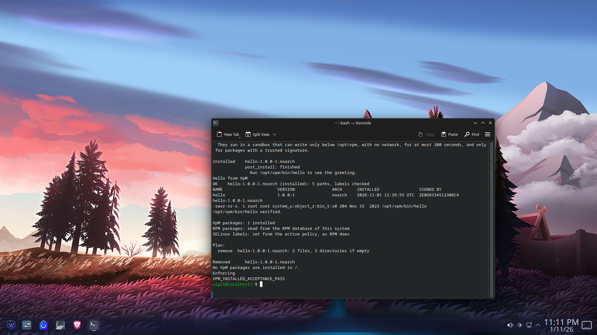 | 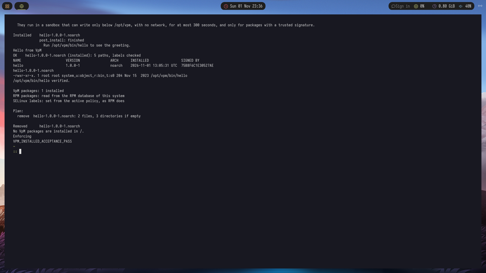 |

When a VpM checkout sits next to this repository in `../VpM`, the ISO build compiles and tests it on this machine and installs it in both editions as the `vpm` RPM. That needs cargo, git, a C compiler and `sqlite-devel`, and the checkout must have no uncommitted changes. `--vpm DIR` uses a checkout somewhere else and `--no-vpm` leaves VpM out. On the installed system, `man vpm` is the reference and `/usr/share/vpm/examples/hello` is an example package to build.

To test a VpM checkout in a throwaway VM:

```bash
bash scripts/test-vpm.sh                 # VpM checkout in ../VpM
bash scripts/test-vpm.sh --vpm DIR       # a checkout somewhere else
bash scripts/test-vpm.sh --points ''     # skip the power-cut tests
```

The script boots the same verified Fedora 44 Cloud image the builds use, and builds VpM and its test packages on this machine. It then runs VpM's system tests as root inside the VM, with SELinux enforcing. For each power-cut test it pauses an install or removal, kills the VM, boots it again and checks that VpM recovers. Nothing is installed on this machine, and the results go in `.build/vpm-test/`.

## VIGIL Ask

VIGIL Ask is a small window for quick questions, answered by [VIGIL GLM](https://vigilglm.ai). **Sign in** shows a short code and opens VIGIL GLM in your browser, where you sign in with email, Google or GitHub (or create a free account), enter the code and connect VIGIL Ask. There's no API key to create, and VIGIL Ask never sees your password. `vigil-ask signin` does the same from a terminal. Questions, and anything you attach, are answered in the cloud by GLM models from Z.ai and use your account's credits, within its plan's limits. The window shows how much of the 5-hour and weekly limits you've used.

VIGIL Ask has no local command tools and requests answers with web search, image generation and browsing switched off. The server must enforce the connection's text-only scope, including its tools, files and saved-memory restrictions. Its tokens are kept in a file only you can read. **Sign out** deletes them locally and requests revocation on VIGIL GLM; account settings also provide Connected desktops. The window's **Settings** choose the model, thinking effort and how long history is kept, **History** reopens a recent conversation, and each code block in an answer has a **Copy code** link. Real-account sign-in, credits, revocation and history behaviour still need acceptance with a test account.

On i3, Super+Shift+A asks through Rofi and Super+Ctrl+A attaches the selected text. Polybar shows the status, and Thunar's Send To menu attaches files. On Plasma, Meta+Alt+A opens the window, Meta+Alt+Shift+A attaches the selected text, and typing `ask` and a question in KRunner sends it. Dolphin's Actions menu attaches text files on both editions. Locking the screen or logging out stops an answer in progress. `man vigil-ask` has the details, and `bash scripts/test-vigil-ask.sh` tests it in a throwaway Fedora 44 VM, with results in `.build/vigil-ask-test/`. Its nested Plasma checks need an existing usable EGL render node for the virtual GPU (`VIGIL_TEST_RENDER_NODE`, default `/dev/dri/renderD128`); the runner makes no host graphics or permission changes.

| VIGIL Ask on KDE | VIGIL Ask on i3 |
| --- | --- |
| 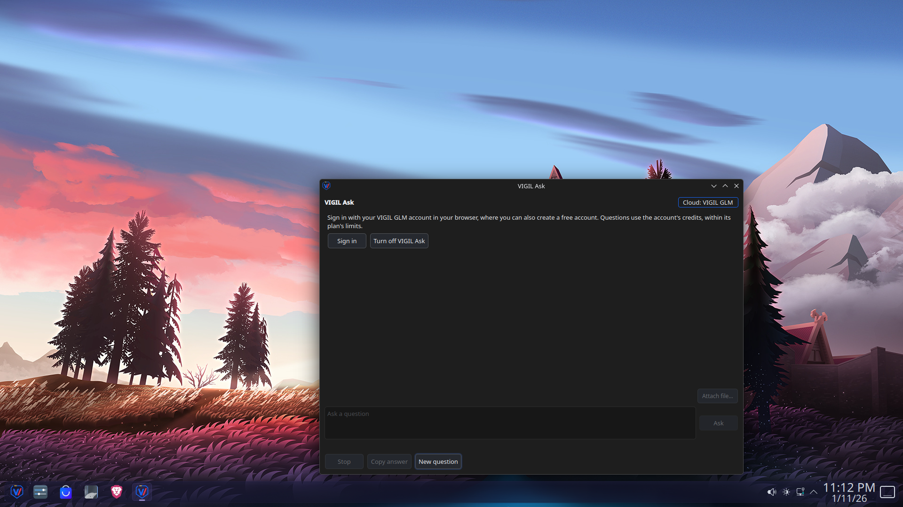 | 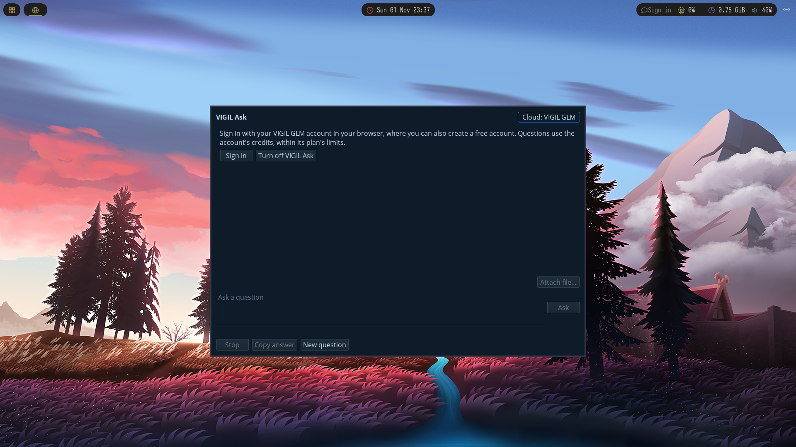 |

These 1.10 screenshots show the current signed-out window. Both editions opened the real device verification page in the ordinary browser and cancelled without approving an account. No production question or billing acceptance was performed.

## Future plans

SIERRA desktop integration is planned: a search field in Plasma, a Rofi prompt in i3, and a task window shared by both. The first version would handle conversation, selected files and a few tested application actions, each with explicit permission. General GUI automation would stay experimental. None of this is implemented yet.

## Credits

The desktop wallpaper is a painting by [byrotek](https://www.deviantart.com/byrotek), used in VIGIL OS. You can find more of his artwork on [his DeviantArt profile](https://www.deviantart.com/byrotek). The painting isn't covered by the VIGIL licence, and this credit must stay with it.

## Licence

VIGIL-owned original material is available under the [VIGIL Personal Build Licence](LICENSE). It permits cloning and building an unmodified copy for personal use, with the documented build and version settings. It requires the branding to remain intact and prohibits commercial redistribution, modification and reuse of covered material in other projects.

These are source-available terms. Fedora, imported software and artwork retain their own licences, and the desktop wallpaper by byrotek is not covered by the VIGIL terms. Existing GPL grants and rights in GPL-covered derivatives remain in effect; the VIGIL terms do not override them. See [LICENSES](LICENSES) and the notices supplied with individual components.

## Developer

Created and maintained by Brad Heffernan for [VIGIL GLM](https://vigilglm.ai).
