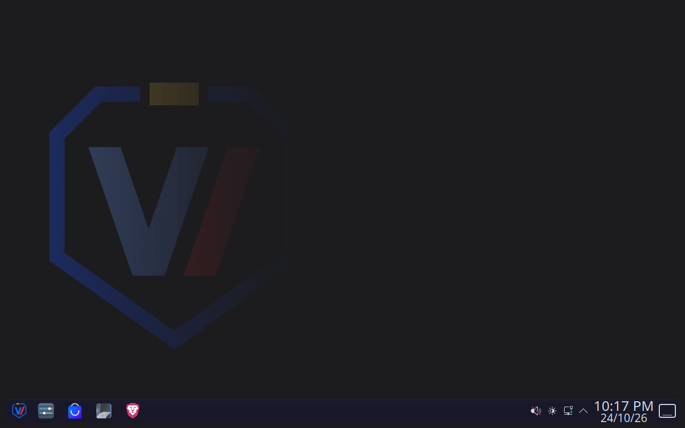
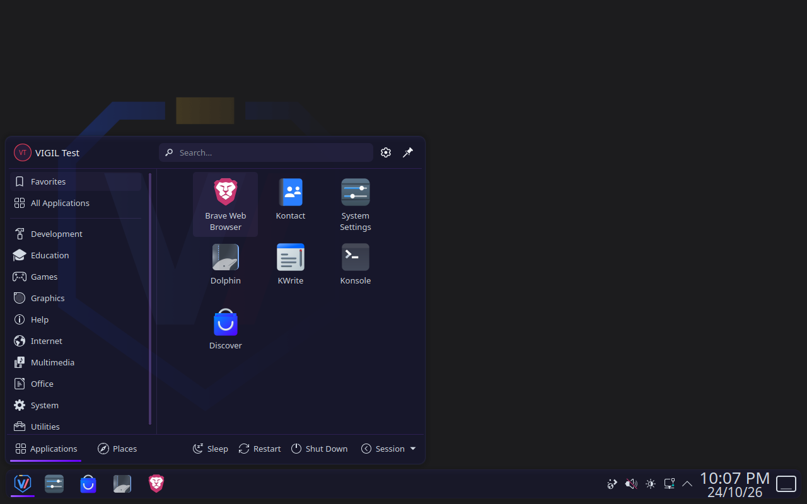
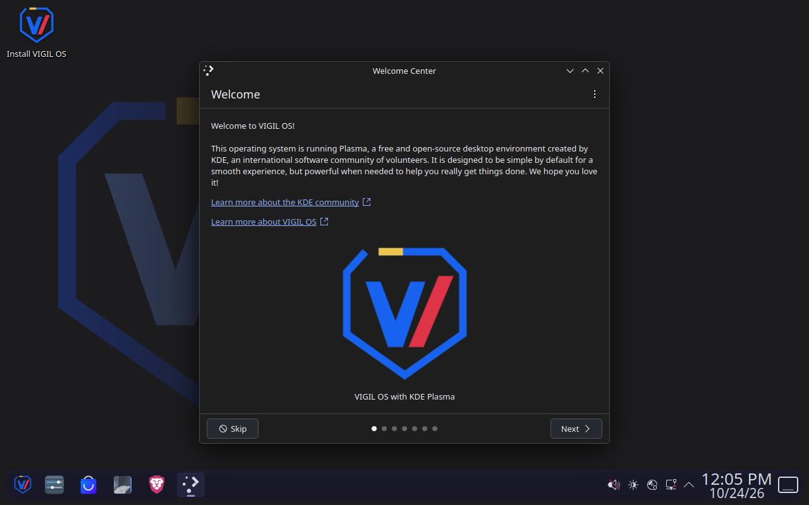
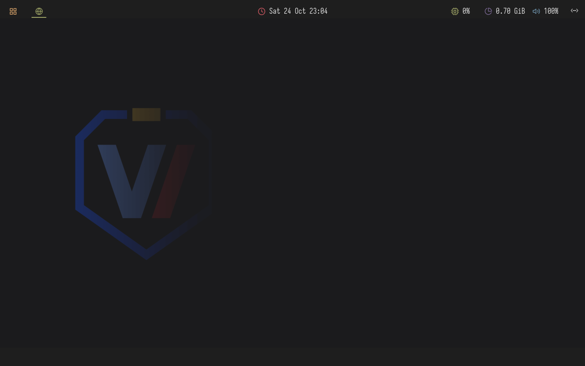
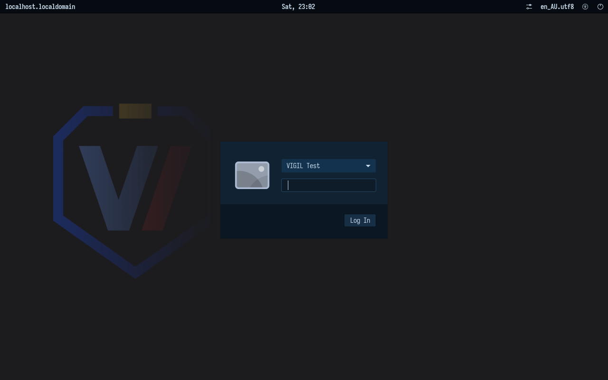

# VIGIL OS

VIGIL OS is a Fedora 44 based Linux distribution created by Brad Heffernan. It has two editions: KDE Plasma on Wayland and i3 on X11. Both use the same dark wallpaper and VIGIL branding across the boot screen, login, desktop and installer.

The KDE edition includes SDDM, Dolphin, Konsole, Kate and Discover. The i3 edition includes LightDM, Polybar, Rofi, i3lock-color, Greenclip, Alacritty and Thunar. Both include Brave as the default browser, LibreOffice, Node.js, npm, Python and Flatpak. System updates use RPM and DNF5 with signed Fedora and Brave repositories.

This is a development project. Earlier 1.2 images passed BIOS and UEFI live boot, fresh UEFI installation, installed login and reboot, updates, lock authentication and display checks in virtual machines. Physical hardware and Secure Boot have not been qualified. Later source checks do not replace testing a newly built ISO.

## Screenshots

### KDE Plasma



| Application menu | Live environment |
| --- | --- |
|  |  |

### i3

| Desktop | Login |
| --- | --- |
|  |  |

## Build the ISO

The host needs Bash, Python 3, curl, gpgv, OpenSSH client tools, xorriso, QEMU, qemu-img and working KVM access. Run the script as your normal user from the repository directory:

```bash
bash scripts/build-and-brand.sh
```

The default builds both editions in sequence. To build one edition or check the source and prerequisites first:

```bash
bash scripts/build-and-brand.sh --desktop kde
bash scripts/build-and-brand.sh --desktop i3
bash scripts/build-and-brand.sh --check
```

The script verifies the Fedora inputs and builds each edition in a fresh disposable VM with 6 GiB of RAM and four CPUs. Package installation, mounts and image preparation run inside that VM. Missing host dependencies are reported for you to install separately.

ISOs, SHA256 checksum files and build evidence are saved under `.build/output/<timestamp>/`. Existing outputs are preserved. Build logs and private temporary VM files stay in `.build/`; do not publish that directory. Workspace, cache and output options are listed by `bash scripts/build-and-brand.sh --help`.

Product versions use `build_number.version_number`. The first number and codename are changed manually in `version.json` for a larger release. Each real build advances the second number once; both editions built together share it. The sequence goes from `1.9` to `1.10`. Checks do not advance it, and deleting `.build` does not reset it. A failed build after version reservation still consumes its number.

## Future plans

SIERRA desktop integration is planned, with a Plasma search field, an i3 Rofi prompt and a shared task window. The initial work would cover conversation, selected files and a small set of tested application actions with explicit permissions. General GUI automation would remain experimental. SIERRA integration is not implemented in this checkout.

[VpM](VPM.md) describes a proposed native package format and package manager. It has no implementation in this checkout. RPM and DNF5 remain responsible for the system.

## Licence

VIGIL-owned original material is available under the [VIGIL Personal Build Licence](LICENSE). It permits cloning and building an unmodified copy for personal use, with the documented build and version settings. It requires the branding to remain intact and prohibits commercial redistribution, modification and reuse of covered material in other projects.

These are source-available terms. Fedora, imported software and artwork retain their own licences. Existing GPL grants and rights in GPL-covered derivatives remain in effect; the VIGIL terms do not override them. See [LICENSES](LICENSES) and the notices supplied with individual components.

## Developer

Created and maintained by Brad Heffernan for [VIGIL GLM](https://vigilglm.ai).
